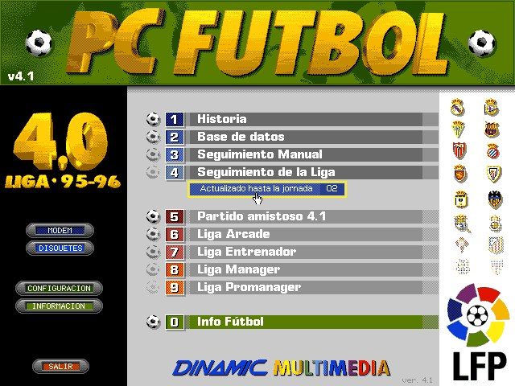
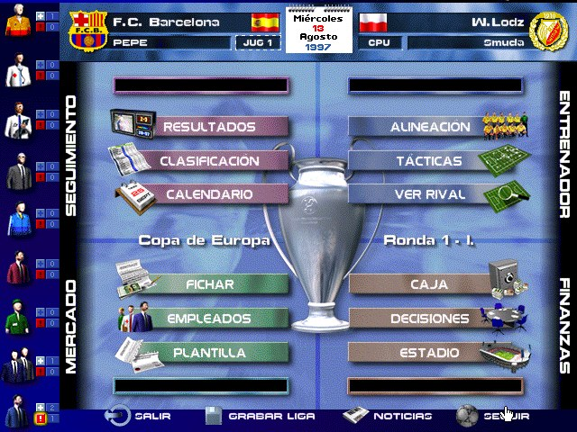
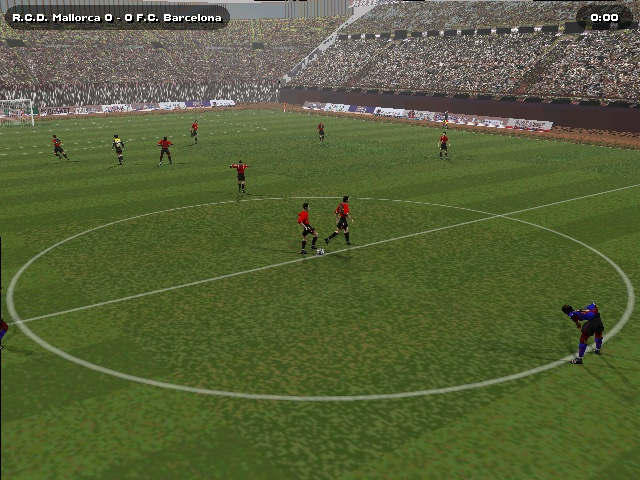
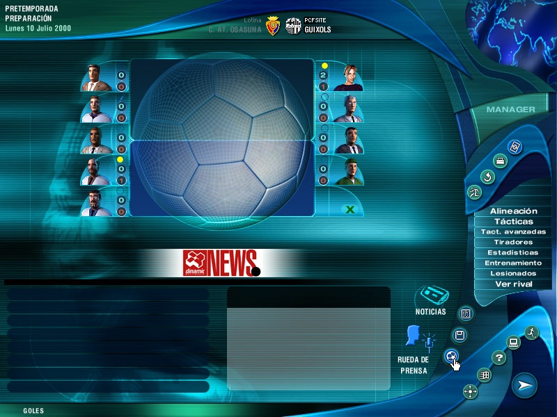
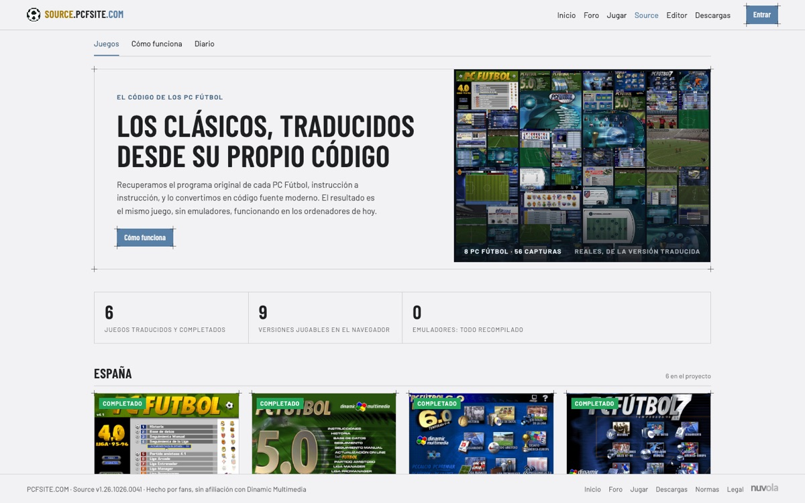
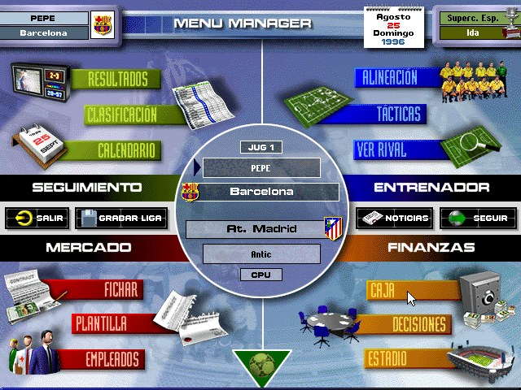
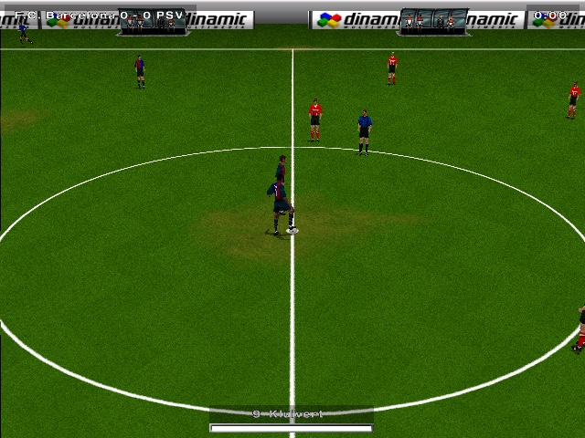
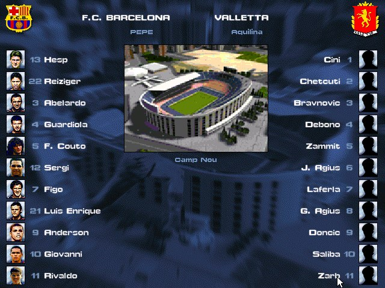

<div align="center">


# PCFSite - Source

**Los clásicos, traducidos desde su propio código.**

Los PCF de Dinamic Multimedia (del 4.0 de 1995 al 2001) recompilados estáticamente de x86 a C, sin emulador, sin máquina
virtual y sin Wine: nativos en macOS, Windows y Linux, y en el navegador con WebAssembly.

[](https://github.com/nuvolacat/pcfsite-source/releases/latest)


<br>






<sub>Capturas reales de la versión traducida.</sub>

</div>

---

## ⚽ Qué es

Cada binario x86 de 32 bits (el `MANAGER.EXE`, las DLL propias de Dinamic y las de Microsoft que venían en el CD) se
traduce instrucción a instrucción a código C, y ese C se compila junto con una **plataforma propia** en C++ que
reimplementa lo que los juegos piden de Windows 98, MS-DOS y DirectX sobre SDL3. El resultado es un programa nativo y,
con Emscripten, un módulo WebAssembly que corre en el navegador.

Del mismo núcleo salen tres cosas:

| Qué | Dónde | Para quién |
|---|---|---|
| 🌐 **La web** [source.pcfsite.com](https://source.pcfsite.com) | `build.py`, `site/`, `data/`, `deploy/`, `servicio/` | jugar en el navegador con la cuenta de pcfsite; las partidas se guardan en la cuenta → [docs/WEB.md](docs/WEB.md) |
| 💻 **La app de escritorio** «PCFSite - Source» | `app/` | macOS 12 o posterior (Apple Silicon e Intel), Windows (x64 y ARM64) y Linux (x86_64 y arm64, compilada desde el fuente): pide el CD original, reproduce la instalación y arranca el juego nativo; mods → [docs/APP.md](docs/APP.md) |
| ⚙️ **El núcleo** | `core/` | el traductor x86→C, la plataforma, el reproductor web, las herramientas y la ficha técnica de cada juego → [docs/COMO-FUNCIONA.md](docs/COMO-FUNCIONA.md) |

> El repo **no contiene ningún fichero de los juegos** ni el C generado a partir de ellos: todo eso es obra derivada del
> original y vive fuera (`core/build/`, ignorado; las carpetas de trabajo `~/<id>-work`). La app pide la ISO del CD al
> usuario y la web sirve los datos desde un bucket aparte. Hecho por fans, sin afiliación con Dinamic Multimedia.

<div align="center">

</div>

## 🎮 Los juegos

Nueve versiones jugables, seis juegos, todos completados (arrancan, se recorren y se juegan: manager, partidos, partidas
guardadas) en nativo y en el navegador. Cada arreglo se anota en el Diario de la ficha (`data/juegos.json`, `hitos`).

| id | Juego | Año | Programa principal | Qué tiene de particular |
|---|---|---|---|---|
| `pcf4` | PCF 4.0 (versión 4.1 del CD) | 1995 | `PCFUTBOL.EXE` (MS-DOS, DOS/4GW) | ejecutables LE de Watcom convertidos a PE (`core/tools/le2pe.py`); VGA 640×480×16 planar, Sound Blaster con DMA e IRQ, int 21h; Manager, Promanager, Historia y Base de datos encadenados por `COMFILE.DAT` |
| `pcf5`, `pcf5oro` | PCF 5.0 y Edición de Oro | 1996, 1997 | `MANAGER.EXE` + 3 DLL | Windows de 16 y 256 colores por GDI; menú y programas del CD encadenados por el lanzador original |
| `pcf6`, `pcf6oro` | PCF 6.0 y Edición de Oro | 1997, 1999 | `MANAGER.EXE` + 2 DLL | DirectDraw, simulador 3D por software (Direct3D 5/6), música S3M |
| `pcf7`, `pcf7plus` | PCF 7 y 7 Plus | 1998, 1999 | `MANAGER.EXE` + 2 DLL, ProQuinielas (Visual Basic) | la línea base del proyecto; el Plus usa DirectInput en el partido |
| `pcf2000` | PCF 2000 con la Extensión | 1999/2000 | `MANAGER.EXE` + 8 DLL, `DBASEWIN` | motor nuevo (gfxwin/d2s2): todo por Direct3D 7, menús incluidos; música MIDI por DirectMusic (sintetizador SoundFont con reverberación); panel de ayuda sobre un WebBrowser falso |
| `pcf2001` | PCF 2001 con las 13 actualizaciones (3.6) | 2000/2001 | `MANAGER.EXE` + 10 DLL, `DBASEWIN` | el mismo motor; música MP3 por DirectShow; MSVCP60 y MSVCIRT traducidas; las actualizaciones se aplican con la propia `patchw32.dll` (RTPatch) traducida (`pcfpatch`) |

Las DLL de Microsoft del CD (MFC42, MSVCRT, MSVCP60, MSVCIRT) se traducen igual que las del juego, porque el juego las
llama de verdad. La ficha técnica de cada uno (binarios, bases de carga, lanzador, parches, notas de instalación) está en
`core/juegos/<id>/juego.json` y su tabla en [`core/juegos/README.md`](core/juegos/README.md).

<div align="center">



</div>

## 🧠 Cómo funciona

```
CD original ──► Ghidra (sin interfaz) ──► functions.tsv        ┐
                                                                ├─► recomp/build.py + lift.py ──► C generado (chunk_*.c, imagen.c…)
EXE y DLL (PE 32 bits; LE→PE en el 4.0) ──► linker.py (bases, IAT, parches) ┘                              │
                                                                                                            ▼
                                   platform/ (C++17, SDL3): Win98 + MS-DOS + DirectX ◄──── CMake ──► nativo (macOS, Windows, Linux)
                                                                                                └──► Emscripten: juego.js + juego.wasm
```

1. **Análisis** con Ghidra en modo headless: funciones de cada binario y descompilado (solo para leer al depurar).
2. **Traducción**: `lift.py` escribe una función C por función x86; la CPU son registros globales y la memoria del
   proceso un array `MEM` de 512 MB. Tan fiel como un emulador y, compilado con `-O2`, tan rápido como código nativo.
3. **Plataforma**: más de mil funciones de 16 DLL de Windows y los objetos COM de DirectX (DirectDraw 1-7, Direct3D 3-7
   por software, DirectSound, DirectInput, DirectMusic, DirectShow); para el 4.0, DOS/4GW, VGA y Sound Blaster.
   Criterio del proyecto: **imitar lo que hace Windows, no parchear el juego**.
4. **Compilación** con CMake (`-DPCF_JUEGO=<id>`) a nativo o, con `emcmake`, a `juego.js` + `juego.wasm`.
5. **Imagen de memoria** reconstruida en el arranque a partir del CD y la instalación del usuario (receta `imagen.c`
   con SHA-256 de cada fichero), así la app no lleva nada del juego.
6. **Inmediatos vivos**: los EXE de los mods surten efecto sin retraducir.

Todo el detalle, paso a paso: **[docs/COMO-FUNCIONA.md](docs/COMO-FUNCIONA.md)**.

## 🗂️ Mapa del repo

```
README.md               este fichero
LICENSE                 GPL-3.0
core/                   el núcleo (core/README.md)
  recomp/               traductor: build.py (orquesta), lift.py (x86→C), linker.py (módulos, IAT, parches), juego.py,
                        winapi_sigs.py (firmas de las APIs a partir de los .spec de Wine)
  platform/             la plataforma C++/SDL3: include/rt.h (CPU y MEM que ve el C generado), src/ (un fichero por
                        subsistema: kernel32, user32, gdi32, ddraw, d3d, dsound, dmusic, dshow, dos/vga/sb, vfs, imagen,
                        compat para Windows…), fonts/ (Liberation), third_party/ (stb_truetype, pl_mpeg, tsf/tml, minimp3)
  web/                  el reproductor del navegador: index.html, inicio.js, partidas.js, backend WasmFS por red
  juegos/<id>/          juego.json (ficha técnica), unresolved.txt (funciones que Ghidra no vio), precarga-caliente.txt,
                        datos_extra/ (ficheros propios que la app añade); pcfpatch/ es el parcheador RTPatch del 2001
  tools/                cpr.py e instalar_nfo.py (reproducir la instalación desde el CD), le2pe.py (DOS/4GW),
                        web_datos.py, web_servir.py, web_probar.py, web_guion.py (Playwright), dls2sf2.py
  ghidra/               run_headless.sh, run_fast.sh y los scripts (FixGaps, ExportAll, DecompAt)
  cmake/mingw.cmake     toolchain de CMake para compilar Windows desde macOS o Linux (llvm-mingw)
  CMakeLists.txt        nativo, web y DLL de Windows; -DPCF_JUEGO=<id>
  build/                (ignorado) C generado, compilaciones y datos preparados para la web
app/                    la app de escritorio (app/README.md, app/CHANGELOG.md, app/VERSION)
  lanzador/             C++17 + SDL3: main.cpp (pantallas, modo terminal, ISO, mods), ui.cpp (interfaz propia con
                        stb_truetype), versiones.cpp (reconocer CD e instalaciones por firmas), instalar.cpp (guiones del
                        instalador, mods), is6.cpp (InstallShield 6), mscab.cpp (cabinets de Microsoft), inflar.cpp
                        (deflate), zip.cpp, json.cpp, util.cpp
  versiones.json        las versiones soportadas: firmas de cada CD, guiones de instalación, binarios (tools/versiones.py)
  tools/versiones.py    genera versiones.json desde las carpetas de trabajo
  mac/                  empaquetar.sh (.app y .dmg), Info.plist, entitlements.plist, pcfsite.icns
  win/                  preparar.sh (llvm-mingw y SDL3 para x86_64 y aarch64), empaquetar.sh (carpeta y zip),
                        lanzador.rc, manifest.xml, pcfsite.ico, LEEME.txt
  linux/                preparar.sh (SDL3 estática), empaquetar.sh (carpeta y tar.gz), instalar.sh, .desktop, LEEME.txt, icono
  assets/, fonts/       logo, carátulas, Barlow (OFL)
build.py                genera dist/ del sitio (portada, /<juego>, /como-funciona, /diario); sin dependencias
data/juegos.json        los juegos en el sitio: estado, resumen, capturas, qué funciona, qué falta, versiones, Diario
site/                   diseño «Industry» (ds.css del foro, comun.css, source.css), topbar.src.js, cuenta.js, tema.js,
                        juego.js (el juego incrustado), visor.js, como-funciona.frag, img/capturas/<id>/
tools/                  servir.py (vista previa), subir_r2.py (datos de los juegos a R2), og.sh (imágenes OG)
deploy.sh, deploy/      despliegue del sitio: nginx-source.pcfsite.com.conf y remote.sh (lo que corre en el servidor)
deploy.env.example      plantilla de los accesos (deploy.env no se versiona)
servicio/               partidas.py: las partidas guardadas en la cuenta de pcfsite; unidad de systemd, cron, copia
docs/                   documentación ampliada (COMO-FUNCIONA, CONSTRUIR, WEB, APP), og.html e imágenes del README
```

Cada carpeta lleva su README: [`core/`](core/README.md), [`core/recomp/`](core/recomp/README.md),
[`core/platform/`](core/platform/README.md), [`core/web/`](core/web/README.md), [`core/juegos/`](core/juegos/README.md),
[`core/tools/`](core/tools/README.md), [`core/ghidra/`](core/ghidra/README.md), [`app/`](app/README.md),
[`deploy/`](deploy/README.md), [`servicio/`](servicio/README.md), [`tools/`](tools/README.md).

## 🔧 Construir

```bash
brew install cmake ninja sdl3                                   # macOS (Linux: ver docs/APP.md#en-linux)
python3 -m venv core/.venv && core/.venv/bin/pip install capstone pefile
(cd core && PCF_JUEGO=pcf7 .venv/bin/python recomp/build.py)   # traducir (hace falta la carpeta de trabajo con el CD)
cmake -G Ninja -S core -B core/build/native-pcf7 -DPCF_JUEGO=pcf7 -DCMAKE_BUILD_TYPE=Release
cmake --build core/build/native-pcf7                            # nativo
app/mac/preparar.sh && app/mac/empaquetar.sh --dmg              # la app (también app/win y app/linux)
python3 build.py && ./deploy.sh                                 # el sitio
```

Requisitos completos, un juego de principio a fin (Ghidra, traducción, nativo y web), empaquetado de la app en los tres
sistemas, el sitio, pruebas sin ventana con guiones y trabajo en ramas: **[docs/CONSTRUIR.md](docs/CONSTRUIR.md)**.

## 🏷️ Versiones

`1.AA.MMDD.HHMM` con la hora del empaquetado (`app/VERSION`); cada versión publicada lleva su entrada en
[`app/CHANGELOG.md`](app/CHANGELOG.md) y se publica como
[*release* de GitHub](https://github.com/nuvolacat/pcfsite-source/releases) con los paquetes de macOS (Apple Silicon e
Intel) y Windows (x64 y ARM64). Última: **1.26.1025.1529**. Linux se compila desde el fuente.

## 🤝 Participar

- **Fallos y propuestas**: [issues](https://github.com/nuvolacat/pcfsite-source/issues/new/choose), con las
  plantillas (juego, sistema, pantalla, registro). Nunca ficheros de los juegos.
- **Preguntas, instalación, novedades**: el [hilo oficial del foro](https://foro.pcfsite.com/t/526).
- **Código**: [CONTRIBUTING.md](CONTRIBUTING.md) (qué hace falta, el criterio del proyecto, pull requests).
- **Seguridad**: [SECURITY.md](SECURITY.md) (aviso en privado).
- **Convivencia**: [CODE_OF_CONDUCT.md](CODE_OF_CONDUCT.md).

## 📜 Licencia

El código de este repositorio es software libre bajo la **GPL-3.0** (`LICENSE`): se puede usar, estudiar, modificar y
redistribuir, con la condición de que las versiones modificadas se publiquen con la misma licencia. Cubre el traductor,
la plataforma, el reproductor web, el lanzador, las herramientas y el sitio. **No cubre los juegos** (su código, sus
datos, sus marcas), que son de sus titulares y no están en el repo, ni el C generado a partir de ellos.

Código de terceros incluido, con sus licencias: `pl_mpeg` (MIT), `stb_truetype` y `stb_image` (dominio público),
TinySoundFont y TinyMidiLoader (MIT), `minimp3` (CC0), el backend de ficheros de WasmFS de Emscripten (MIT), las fuentes
Liberation y Barlow (SIL Open Font License). El lector de InstallShield 6 está reescrito a partir de lo que documenta
unshield; las firmas de las APIs de Windows se generan a partir de los `.spec` de Wine.

---

<div align="center">
<br>


Comunidad: [pcfsite.com](https://www.pcfsite.com) · Creado por [@jordirubo](https://github.com/jordirubo)

© NUVOLACAT
</div>
